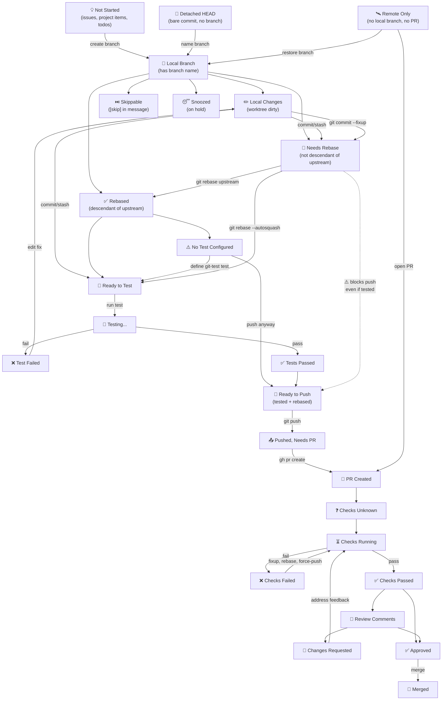
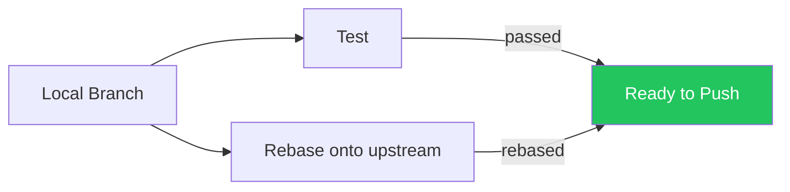
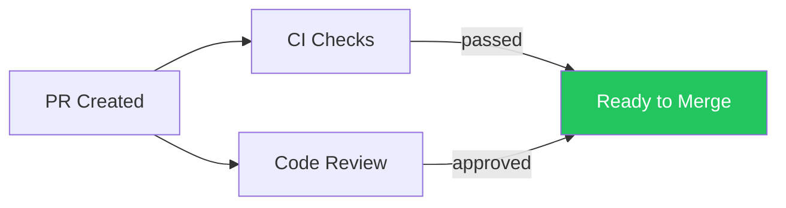

# Work-in-Progress Stages

This document describes the lifecycle stages that work items move through in WIP, from initial idea to merged PR.

## Overview

WIP tracks work across multiple git repositories. Each piece of work starts as an idea (issue, project item, todo) and progresses through local development, testing, pushing, PR creation, CI checks, and code review. The system discovers work automatically from git state and GitHub APIs.

## Simple Diagram (NFA)

This diagram shows the intuitive flow. It hides combinatorial state — many of these dimensions are independent and can combine in ways the diagram doesn't show.

## State Dimensions (DFA model)

The simple diagram above is an NFA — it hides the fact that many dimensions are independent. The real state of a work item is the combination of all these dimensions. This section enumerates them, like converting an NFA to a DFA.

GitHub's GraphQL API has a `MergeStateStatus` enum (BEHIND, BLOCKED, CLEAN, DIRTY, DRAFT, HAS_HOOKS, UNKNOWN, UNSTABLE) that covers ~8 states for the PR-merge phase only. Our model extends this to cover the full local-to-merged lifecycle. The **Conflicts** and **Draft** dimensions below are inspired by GitHub's DIRTY and DRAFT states.

### Item dimensions

These are properties of an individual work item (commit, branch, or PR).

| Dimension         | Values                                                    | Notes                                                           |
| ----------------- | --------------------------------------------------------- | --------------------------------------------------------------- |
| **Work type**     | `idea` / `bare_commit` / `branch` / `pr`                  | What kind of thing is it                                        |
| **Commits ahead** | 0 / 1 / n                                                 | Single-commit branches are most ready                           |
| **Worktree**      | `clean` / `dirty`                                         | Dirty blocks testing                                            |
| **Rebased**       | `yes` / `no`                                              | Is upstream/main an ancestor of this branch                     |
| **Conflicts**     | `none` / `has_conflicts`                                  | Can rebase cleanly, or has merge conflicts (from GitHub: DIRTY) |
| **Test result**   | `untested` / `passed` / `failed`                          | Result of `git test run`                                        |
| **Remote sync**   | `local_only` / `in_sync` / `local_ahead` / `remote_ahead` | Relationship between local and remote branch                    |
| **Draft**         | `n/a` / `yes` / `no`                                      | PR opened as draft for early CI feedback (from GitHub: DRAFT)   |
| **CI checks**     | `n/a` / `unknown` / `running` / `passed` / `failed`       | GitHub Actions status                                           |
| **Review**        | `n/a` / `comments` / `changes_requested` / `approved`     | PR review status                                                |
| **Override**      | `normal` / `snoozed` / `skippable`                        | User explicitly deprioritized                                   |

### Project dimensions

These are properties of the project, not any individual item. They block or alter the progression of all items in that project.

| Dimension            | Values                              | Notes                                                                                                                      |
| -------------------- | ----------------------------------- | -------------------------------------------------------------------------------------------------------------------------- |
| **Test defined**     | `yes` / `no`                        | Does the project have `git test` configured                                                                                |
| **Upstream fetched** | `fresh` / `stale`                   | Has upstream been fetched recently                                                                                         |
| **Upstream red**     | `green` / `own red` / `foreign red` | Failed check runs on the upstream tip (a run GitHub never started is no result), or a failed local baseline `git test run` |
| **PR refs**          | `fetched` / `missing`               | Does the PR remote fetch `+refs/pull/*/head:refs/remotes/<remote>/pr/*`                                                    |

**Blockers rank above what they block.** A card that keeps other cards from showing up or landing ranks earliest, above the pinned Ready to land section: /queue opens with Set Up PR Refs (without the refspec wip can't tell a lost remote-only commit from a PR-covered one, so other cards may be missing), then Upstream Red (it stops that repo's commits from landing), then Ready to land, then the commit categories. /kanban's columns, the queue table and the category numbering follow the same order (`BLOCKING_CATEGORIES` in `packages/web/src/lib/category-actions.ts`).

**Upstream red** is the first project-level property surfaced as a project-level item. An own red upstream (owner is the user's login or one of `ownership.orgs`) stops the repo's line: it becomes one `upstream_red` queue item per repo (`upstream_ci` child, ranked right after Set Up PR Refs and above Ready to land on /queue, and second on /kanban) naming the failing checks or "local baseline test failed", how long it has been red (the failing upstream commit's date), and one action (`/github:gha` for CI, `/build:fix` for a local baseline). The ready buffer pulls nothing in that repo, Ready to land lists none of its commits, and every commit card and item page in it shows "Blocked: `<repo>`'s upstream is red", linking to the item. A foreign red upstream gets no item and blocks nothing: it is the baseline, and a commit that adds no new failure to it is still ready. A check run GitHub never started (an Actions job that never got a runner, or one refused for billing: "The job was not started because recent account payments have failed or your spending limit needs to be increased") is no CI result, neither pass nor fail, so a repo whose only failing checks never started is red only if its local baseline fails, and its commits line up by local tests. The same holds wherever wip reads check conclusions: a PR row is not Checks Failed and draft-PR verification is not red for such a run. wip asks GitHub once per refresh for all failing check runs' steps and annotations (`notStartedCheckRuns` in `packages/shared/src/lib/gha-checks.ts`).

**PR refs** is the second project-level item. The remote that holds the repo's PRs (`upstreamRemote`: upstream for a fork, origin for a repo without one) should fetch GitHub's PR heads with `+refs/pull/*/head:refs/remotes/<remote>/pr/*`. A repo whose PR remote has no `refs/pull/` fetch refspec gets one `pr_refs_missing` queue item (ranked first on /queue, above Upstream Red and Ready to land, and first on /kanban) naming the remote, with one action, Set up PR refs, which runs `git config --add remote.<remote>.fetch ...` and fetches that remote. wip never adds the refspec on its own and touches only the repo the user clicked. The item is not a commit: it counts toward no commit, WIP, red or ready count and never enters the ready buffer.

**Remote only** (`remote_only`) is the state of a commit that only a remote-tracking branch holds: no local branch, no user worktree, and no pull request covering it (no `refs/remotes/<remote>/pr/<n>` ref contains it, and no open PR names the branch holding it), as when a branch pushed to the fork is deleted locally. That work is effectively lost, so it is listed (ranked after PR refs on /queue and /kanban) with "Remote only: no local branch, no PR · `<remote>/<branch>`" and three actions: Restore branch (`git branch <name> <remote>/<name>`, the primary; it never overwrites a local branch), Open PR (GitHub's prefilled new-PR page from that branch) and Delete remote branch (`git push <remote> --delete <name>`, outward-facing, so it asks first). On hold aside, it is checked before every commit state, so a green remote-only commit is never Ready to Push, never in the ready buffer and never counted ready; it does count toward WIP. A remote-only commit a PR covers is that PR's: it stays unlisted, as does a commit only wip's own worktrees hold. `<remote>/HEAD` never counts as a holding branch.

### Constraints (unreachable combinations)

Not all dimension combinations are possible. These constraints prune the DFA:

| Constraint                                              | Reason                                              |
| ------------------------------------------------------- | --------------------------------------------------- |
| `bare_commit` → remote_sync = `local_only`              | Can't push without a branch                         |
| `bare_commit` → rebased = `yes`                         | Bare commits are children of upstream by definition |
| `idea` → all git dimensions are `n/a`                   | Ideas have no git state                             |
| `pr` → remote_sync ≠ `local_only`                       | PR requires a pushed branch                         |
| CI checks ≠ `n/a` → work_type = `pr`                    | Only PRs have CI checks                             |
| Review ≠ `n/a` → work_type = `pr`                       | Only PRs have reviews                               |
| test_result ≠ `untested` → test_defined = `yes`         | Can't have test results without a test              |
| worktree = `dirty` → test_result = `untested`           | Can't test with uncommitted changes                 |
| conflicts = `has_conflicts` → rebased = `no`            | Conflicts only matter when not rebased              |
| rebased = `yes` → conflicts = `none`                    | Successfully rebased means no conflicts             |
| draft = `yes` → review = `n/a`                          | Draft PRs don't have review status                  |
| draft ≠ `n/a` → work_type = `pr`                        | Only PRs can be drafts                              |
| remote_sync = `local_only` → CI checks = `n/a`          | Nothing pushed, no CI                               |
| snoozed/skippable → all other dimensions are irrelevant | User override, shown last regardless                |

### Full State Table (DFA)

Every reachable state combination, numbered by priority (highest = most done). The queue shows items in descending order.

#### Override states (shown last regardless of other dimensions)

| #   | State     | Override    |
| --- | --------- | ----------- |
| 1   | Snoozed   | `snoozed`   |
| 2   | Skippable | `skippable` |

#### Idea states (no git state)

| #   | State                      | Work type                     |
| --- | -------------------------- | ----------------------------- |
| 3   | Not started (todo)         | `idea` (todo file)            |
| 4   | Not started (issue)        | `idea` (GitHub issue)         |
| 5   | Not started (project item) | `idea` (GitHub project board) |

#### Bare commit states (detached HEAD, no branch)

| #   | State                    | Worktree | Test def | Test result | Notes                      |
| --- | ------------------------ | -------- | -------- | ----------- | -------------------------- |
| 6   | Bare commit, dirty       | dirty    | —        | untested    | Needs commit, then branch  |
| 7   | Bare commit, no test     | clean    | no       | untested    | Needs branch + test config |
| 8   | Bare commit, untested    | clean    | yes      | untested    | Needs branch, then test    |
| 9   | Bare commit, test failed | clean    | yes      | failed      | Fix, then create branch    |
| 10  | Bare commit, test passed | clean    | yes      | passed      | Just needs a branch name   |

#### Branch states (local development)

| #   | State                                       | Commits | Worktree | Rebased | Conflicts | Test def | Test result | Remote sync | Notes                                        |
| --- | ------------------------------------------- | ------- | -------- | ------- | --------- | -------- | ----------- | ----------- | -------------------------------------------- |
| 11  | Branch, dirty                               | any     | dirty    | —       | —         | —        | untested    | —           | Needs commit                                 |
| 12  | Branch, no test, conflicts                  | any     | clean    | no      | yes       | no       | untested    | local_only  | Resolve conflicts, then rebase + test config |
| 13  | Branch, no test, not rebased                | any     | clean    | no      | no        | no       | untested    | local_only  | Rebase, then needs test config               |
| 14  | Branch, no test, rebased                    | any     | clean    | yes     | —         | no       | untested    | local_only  | Stuck: needs test config                     |
| 15  | Branch, conflicts, untested                 | any     | clean    | no      | yes       | yes      | untested    | local_only  | Resolve conflicts, rebase, test              |
| 16  | Branch, not rebased, untested               | any     | clean    | no      | no        | yes      | untested    | local_only  | Rebase, then test                            |
| 17  | Branch, rebased, untested                   | any     | clean    | yes     | —         | yes      | untested    | local_only  | Ready to test                                |
| 18  | Branch, conflicts, test failed              | any     | clean    | no      | yes       | yes      | failed      | local_only  | Fix, resolve conflicts, rebase, retest       |
| 19  | Branch, not rebased, test failed            | any     | clean    | no      | no        | yes      | failed      | local_only  | Fix, rebase, retest                          |
| 20  | Branch, rebased, test failed                | any     | clean    | yes     | —         | yes      | failed      | local_only  | Fix and retest                               |
| 21  | Branch, not rebased, test passed            | any     | clean    | no      | no        | yes      | passed      | local_only  | Rebase (invalidates test?)                   |
| 22  | Branch, rebased, test passed, multi-commit  | n>1     | clean    | yes     | —         | yes      | passed      | local_only  | Split or squash, then push                   |
| 23  | Branch, rebased, test passed, single-commit | 1       | clean    | yes     | —         | yes      | passed      | local_only  | Ready to push                                |

#### Pushed states (remote branch exists, no PR yet)

| #   | State                         | Remote sync | Notes                      |
| --- | ----------------------------- | ----------- | -------------------------- |
| 24  | Pushed, in sync, needs PR     | in_sync     | Create PR                  |
| 25  | Pushed, local ahead, needs PR | local_ahead | Push first, then create PR |

#### Draft PR states (early CI feedback, not requesting review)

| #   | State                    | Remote sync | Draft | CI checks | Notes                 |
| --- | ------------------------ | ----------- | ----- | --------- | --------------------- |
| 26  | Draft PR, checks unknown | in_sync     | yes   | unknown   | Waiting for CI        |
| 27  | Draft PR, checks running | in_sync     | yes   | running   | CI in progress        |
| 28  | Draft PR, checks failed  | in_sync     | yes   | failed    | Fix, force-push       |
| 29  | Draft PR, checks passed  | in_sync     | yes   | passed    | Mark ready for review |

#### PR states (CI checks + review)

| #   | State                                | Remote sync | Draft | CI checks | Review            | Notes                  |
| --- | ------------------------------------ | ----------- | ----- | --------- | ----------------- | ---------------------- |
| 30  | PR, checks unknown                   | in_sync     | no    | unknown   | n/a               | Waiting for CI         |
| 31  | PR, checks running                   | in_sync     | no    | running   | n/a               | CI in progress         |
| 32  | PR, checks failed                    | in_sync     | no    | failed    | n/a               | Fix, force-push        |
| 33  | PR, checks failed, local ahead       | local_ahead | no    | failed    | n/a               | Need to force-push fix |
| 34  | PR, checks passed, no review         | in_sync     | no    | passed    | n/a               | Request review         |
| 35  | PR, checks passed, review comments   | in_sync     | no    | passed    | comments          | Address comments       |
| 36  | PR, checks passed, changes requested | in_sync     | no    | passed    | changes_requested | Address feedback       |
| 37  | PR, checks running, approved         | in_sync     | no    | running   | approved          | Wait for CI            |
| 38  | PR, checks passed, approved          | in_sync     | no    | passed    | approved          | Ready to merge         |

## Diamonds

### Diamond: Rebase + Test

The most important structural insight is that **rebase** and **test** are independent, parallel requirements that must both be satisfied before pushing:

A branch can be:

- **Tested but not rebased** — tests passed on the old base, needs `git rebase upstream/main`
- **Rebased but not tested** — freshly rebased, needs test run
- **Neither** — just created, needs both
- **Both** — ready to push

This means after a rebase, tests should re-run (since the code has changed). And after fixing a test failure, you don't need to re-rebase (the base hasn't changed). The classify logic should track these independently.

### Diamond: CI Checks + Review

A second diamond exists after PR creation:

Currently the UI treats these as a linear sequence (checks → review → approved), but in practice:

- A reviewer can approve while checks are still running
- Checks can pass before review is requested
- Both must be green to merge

## Card Ordering Within Categories

Within each kanban column or queue category, cards are ordered by readiness — how close they are to being pushed to GitHub:

1. **Pull requests** — already on GitHub, furthest along
2. **Single-commit branches** (`commitsAhead = 1`) — just need `git push`
3. **Bare commits** — need a branch name created, then push
4. **Multi-commit branches** (`commitsAhead > 1`) — need splitting or squashing before landing
5. **Issues, project items, todos** — not yet started

This reflects a one-commit-at-a-time workflow where each branch should ideally contain a single atomic commit.

## Classify Logic → DFA Mapping

The `classify.ts` module maps items to the `Category` enum. This section traces every code path and maps it to a DFA state, revealing which states are distinguished vs collapsed.

### classifyCommit (bare commits — CommitItem)

| Code path                        | Category        | DFA # | DFA state                  | Notes                                      |
| -------------------------------- | --------------- | ----- | -------------------------- | ------------------------------------------ |
| `commit.skippable`               | `skippable`     | 2     | Skippable                  |                                            |
| `commit.testStatus === 'failed'` | `test_failed`   | 9     | Bare commit, test failed   |                                            |
| `commit.testStatus === 'passed'` | `ready_to_push` | 10    | Bare commit, test passed   |                                            |
| `project.detachedHead`           | `detached_head` | 6–8   | Bare commit (any untested) | Collapses dirty/no-test/untested substates |
| `project.dirty`                  | `local_changes` | 6     | Bare commit, dirty         |                                            |
| `!project.hasTestConfigured`     | `no_test`       | 7     | Bare commit, no test       |                                            |
| default                          | `ready_to_test` | 8     | Bare commit, untested      |                                            |

CommitItem now has `testStatus`, so states #9 and #10 are reachable. The `detachedHead` check still collapses the untested substates (#6–8) when reached before the dirty/no-test checks.

### classifyBranch (branches — BranchItem)

| Code path                               | Category        | DFA #  | DFA state                          | Notes                                   |
| --------------------------------------- | --------------- | ------ | ---------------------------------- | --------------------------------------- |
| `branch.skippable`                      | `skippable`     | 2      | Skippable                          |                                         |
| `testStatus === 'failed'`               | `test_failed`   | 18–20  | Branch, test failed                | Not checking rebased or conflicts       |
| `pushedToRemote && localAhead`          | `ready_to_push` | 25     | Pushed, local ahead, needs PR      | Local has unpushed commits              |
| `pushedToRemote && branch !== upstream` | `pushed_no_pr`  | 24     | Pushed, in sync, needs PR          |                                         |
| `branch.needsRebase`                    | `needs_rebase`  | 13, 16 | Branch, not rebased                | Distinguishes needs-rebase from rebased |
| `testStatus === 'passed'`               | `ready_to_push` | 23     | Branch, test passed, single-commit | Not checking rebased                    |
| `project.dirty`                         | `local_changes` | 11     | Branch, dirty                      |                                         |
| `!project.hasTestConfigured`            | `no_test`       | 12–14  | Branch, no test                    | Not checking rebased or conflicts       |
| default                                 | `ready_to_test` | 15–17  | Branch, untested                   | Not checking rebased or conflicts       |

**Now distinguished**: `needsRebase` check separates not-rebased branches (#13, #16) from rebased ones. `localAhead` check separates pushed-but-ahead (#25) from in-sync (#24).

**Still collapsed**: `rebaseable` (conflict detection) exists on BranchItem but classify ignores it, so conflict states #12, #15, #18 are collapsed with their non-conflict counterparts. State #19 (not rebased, test failed) is collapsed with #20 because `testStatus === 'failed'` is checked before `needsRebase`.

### classifyPullRequest (PRs — PullRequestItem)

| Code path                                                 | Category            | DFA #  | DFA state                      | Notes                                                      |
| --------------------------------------------------------- | ------------------- | ------ | ------------------------------ | ---------------------------------------------------------- |
| `pr.skippable`                                            | `skippable`         | 2      | Skippable                      |                                                            |
| `checkStatus === 'failed' && localAhead`                  | `ready_to_push`     | 33     | PR, checks failed, local ahead | Fix already committed locally                              |
| `checkStatus === 'failed'`                                | `checks_failed`     | 32     | PR, checks failed              | Checked before review — blocks approved                    |
| `checkStatus === 'running'/'pending'`                     | `checks_running`    | 31, 37 | PR, checks running             | Checked before review — collapses #37 (approved + running) |
| `reviewStatus === 'approved' && checkStatus === 'passed'` | `approved`          | 38     | PR, approved                   | Both checks and review must pass                           |
| `reviewStatus === 'changes_requested'`                    | `changes_requested` | 36     | PR, changes requested          | After CI blocking checks                                   |
| `reviewStatus === 'commented'`                            | `review_comments`   | 35     | PR, review comments            | After CI blocking checks                                   |
| `checkStatus === 'passed'`                                | `checks_passed`     | 34     | PR, checks passed              |                                                            |
| `checkStatus === 'unknown'/'none'`                        | `checks_unknown`    | 30     | PR, checks unknown             |                                                            |
| default                                                   | `checks_running`    | 31     | PR, checks running             | Fallback                                                   |

**Now distinguished**: `localAhead` check separates #33 (checks failed + local ahead, shown as `ready_to_push`) from #32 (checks failed, in sync).

**Still collapsed**: Draft PR states #26–29 not distinguished (no draft field on PullRequestItem). State #37 (checks running + approved) collapsed with #31 (checks running).

### Idea items (not classified — added directly in useWorkItems)

| Source            | DFA # | DFA state                  |
| ----------------- | ----- | -------------------------- |
| TodoItem          | 3     | Not started (todo)         |
| IssueItem         | 4     | Not started (issue)        |
| ProjectItemResult | 5     | Not started (project item) |
| SnoozedChild      | 1     | Snoozed                    |

### Summary: DFA states reachable in current code

| DFA # | State                                | Reachable?    | Via                                                                                |
| ----- | ------------------------------------ | ------------- | ---------------------------------------------------------------------------------- |
| 1     | Snoozed                              | yes           | snoozed query                                                                      |
| 2     | Skippable                            | yes           | all three classifiers                                                              |
| 3     | Not started (todo)                   | yes           | useWorkItems                                                                       |
| 4     | Not started (issue)                  | yes           | useWorkItems                                                                       |
| 5     | Not started (project item)           | yes           | useWorkItems                                                                       |
| 6     | Bare commit, dirty                   | yes           | classifyCommit                                                                     |
| 7     | Bare commit, no test                 | yes           | classifyCommit                                                                     |
| 8     | Bare commit, untested                | yes           | classifyCommit                                                                     |
| 9     | Bare commit, test failed             | yes           | classifyCommit (`testStatus === 'failed'`)                                         |
| 10    | Bare commit, test passed             | yes           | classifyCommit (`testStatus === 'passed'`)                                         |
| 11    | Branch, dirty                        | yes           | classifyBranch                                                                     |
| 12    | Branch, no test, conflicts           | **collapsed** | shown as #14 (no_test)                                                             |
| 13    | Branch, no test, not rebased         | yes           | classifyBranch (`needsRebase`)                                                     |
| 14    | Branch, no test, rebased             | yes           | classifyBranch                                                                     |
| 15    | Branch, conflicts, untested          | **collapsed** | shown as #17 (ready_to_test)                                                       |
| 16    | Branch, not rebased, untested        | yes           | classifyBranch (`needsRebase`)                                                     |
| 17    | Branch, rebased, untested            | yes           | classifyBranch                                                                     |
| 18    | Branch, conflicts, test failed       | **collapsed** | shown as #20 (test_failed)                                                         |
| 19    | Branch, not rebased, test failed     | **collapsed** | shown as #20 (test_failed); `testStatus === 'failed'` checked before `needsRebase` |
| 20    | Branch, rebased, test failed         | yes           | classifyBranch                                                                     |
| 21    | Branch, not rebased, test passed     | yes           | classifyBranch (`needsRebase` checked before `testStatus === 'passed'`)            |
| 22    | Branch, rebased, test passed, multi  | **collapsed** | shown as #23 (ready_to_push)                                                       |
| 23    | Branch, rebased, test passed, single | yes           | classifyBranch                                                                     |
| 24    | Pushed, in sync, needs PR            | yes           | classifyBranch (`pushedToRemote && !localAhead`)                                   |
| 25    | Pushed, local ahead, needs PR        | yes           | classifyBranch (`pushedToRemote && localAhead`)                                    |
| 26    | Draft PR, checks unknown             | **collapsed** | shown as #30 (no draft detection)                                                  |
| 27    | Draft PR, checks running             | **collapsed** | shown as #31 (no draft detection)                                                  |
| 28    | Draft PR, checks failed              | **collapsed** | shown as #32 (no draft detection)                                                  |
| 29    | Draft PR, checks passed              | **collapsed** | shown as #34 (no draft detection)                                                  |
| 30    | PR, checks unknown                   | yes           | classifyPullRequest                                                                |
| 31    | PR, checks running                   | yes           | classifyPullRequest                                                                |
| 32    | PR, checks failed                    | yes           | classifyPullRequest                                                                |
| 33    | PR, checks failed, local ahead       | yes           | classifyPullRequest (`localAhead`, shown as ready_to_push)                         |
| 34    | PR, checks passed, no review         | yes           | classifyPullRequest                                                                |
| 35    | PR, review comments                  | yes           | classifyPullRequest                                                                |
| 36    | PR, changes requested                | yes           | classifyPullRequest                                                                |
| 37    | PR, checks running, approved         | **collapsed** | shown as #31 (checks_running)                                                      |
| 38    | PR, approved                         | yes           | classifyPullRequest                                                                |

**29 of 38 states are reachable.** 9 are collapsed:

- 4 collapsed (draft PRs — no draft field on PullRequestItem)
- 3 collapsed (conflict states #12, #15, #18 — `rebaseable` field exists but classify ignores it)
- 1 collapsed (needsRebase not checked when test failed: #19 — `testStatus === 'failed'` checked before `needsRebase`)
- 1 collapsed (approved + checks running #37 — `checkStatus` checked before `reviewStatus`)

### Changes since initial analysis

The following states became reachable through code changes after the DFA model was first documented:

| DFA # | State                            | Change                                                                   |
| ----- | -------------------------------- | ------------------------------------------------------------------------ |
| 9     | Bare commit, test failed         | `testStatus` added to CommitItem schema                                  |
| 10    | Bare commit, test passed         | `testStatus` added to CommitItem schema                                  |
| 13    | Branch, no test, not rebased     | `needsRebase` check added to classifyBranch                              |
| 16    | Branch, not rebased, untested    | `needsRebase` check added to classifyBranch                              |
| 21    | Branch, not rebased, test passed | `needsRebase` checked before `testStatus === 'passed'` in classifyBranch |
| 25    | Pushed, local ahead, needs PR    | `localAhead` check added to classifyBranch                               |
| 33    | PR, checks failed, local ahead   | `localAhead` check added to classifyPullRequest                          |

## Current Limitations

### Missing: Conflict Detection

The `rebaseable` field exists on BranchItem (computed via `git merge-tree`) but classify ignores it. Branches that need rebase should be split into "clean rebase" (automatic, just run `git rebase`) vs "conflicted rebase" (requires manual conflict resolution). Conflicted branches are harder to fix and should rank lower. Inspired by GitHub's `MergeStateStatus.DIRTY`.

### Missing: Draft PR Detection

Draft PRs are a real intermediate state between "pushed, needs PR" and "PR ready for review." They're used to get early CI feedback without requesting review. The current code doesn't distinguish draft from non-draft PRs. Inspired by GitHub's `MergeStateStatus.DRAFT`.

### Missing: Rebase Check After Test Failure

The `needsRebase` check in classifyBranch occurs after the `testStatus === 'failed'` check, so branches that have failed tests AND need rebase (#19) are classified as `test_failed` rather than showing both the rebase requirement and the test failure. For passed tests, `needsRebase` is checked first, so #21 (not rebased, test passed) correctly shows as `needs_rebase`.

### Missing: Approved + Checks Running

State #37 (approved but checks still running) is collapsed with #31 (checks running). The `checkStatus` is checked before `reviewStatus`, so an approved PR with running checks shows as `checks_running` rather than a distinct "approved, waiting for CI" state.

### Missing: Project-Level Properties

`no_test` and `upstream_stale` are properties of the **project**, not individual items. They should be surfaced as project-level warnings when that project has active work items, rather than mixed into the item state machine. Upstream red already is: see **Upstream red** under Project dimensions.
